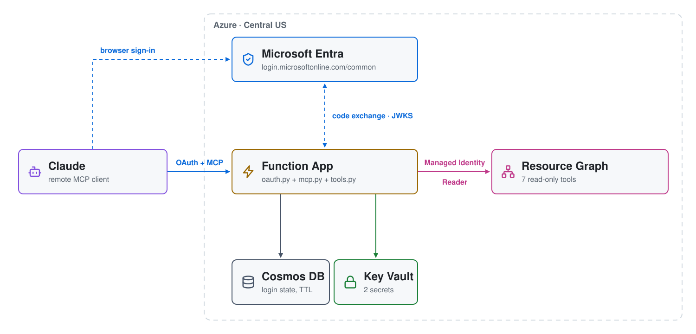
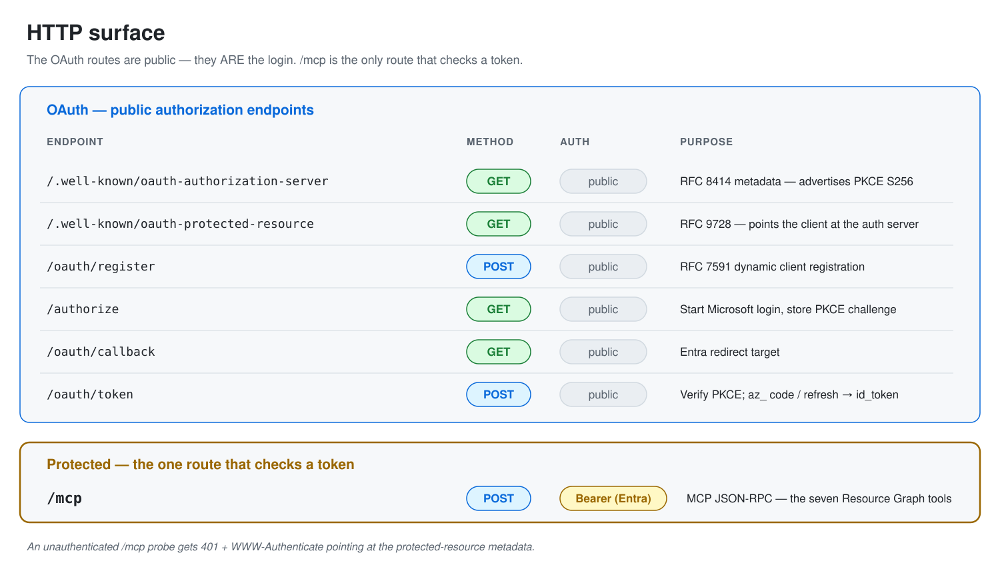

# Azure OAuth MCP — a remote MCP server on Azure Functions, secured with Entra

Connect **Claude** or **ChatGPT** directly to your Azure subscription — both
use the same URL. No local proxy. No
service-principal secret in a config file. You paste one URL, log in with any
Microsoft account — work, school, or personal — and the tools work.

This is the OAuth port of `azure-serverless-mcp`, which kept a local proxy that
authenticated with a **long-lived service-principal client secret embedded in
the Claude Desktop config** — one static credential for all access, sitting in a
JSON file. This version deletes it.

| | Proxy build | This build |
|---|---|---|
| Client setup | Install proxy, edit JSON config, hold a secret | Paste one URL |
| Credential on disk | SP client secret, never expires | None |
| Who is the caller? | Always the same service principal | The actual human, via Entra |
| Auth enforced by | The code (in-code JWT) | The code (in-code JWT) |
| Identity model | one tenant, one SP | any Microsoft account, real users |

---

## Architecture

<picture>
  <source media="(prefers-color-scheme: dark)" srcset="architecture-dark.svg">
  
</picture>

Regenerate the diagrams with `python make_diagram.py`.

Claude and ChatGPT walk the same six steps:

1. **Probe** — the client calls `POST /mcp` with no token and gets a 401 with a
   `WWW-Authenticate` header.
2. **Discover** — `GET /.well-known/oauth-authorization-server` (RFC 8414).
3. **Register** — `POST /oauth/register` (RFC 7591).
4. **Login** — `GET /authorize` → login.microsoftonline.com → `/oauth/callback`.
5. **Token** — `POST /oauth/token`.
6. **Use** — `POST /mcp` with `Authorization: Bearer <entra token>`.

One **Function App** (Flex Consumption) does all of it — public, with auth
enforced in code:

- `oauth.py` — the OAuth broker, with transient login state in **Cosmos DB**
  (5-min TTL)
- `mcp.py` — JSON-RPC; validates the Bearer token against Entra's JWKS
- `tools.py` — 7 Resource Graph tools, called in-process with the Function
  App's **Managed Identity** (subscription Reader)

The Function App plays **two roles at once**. To the MCP client it *is* the
OAuth authorization server. To Microsoft Entra it is an ordinary OAuth *client*.

### Why a broker, and not just "point the client at Entra"?

Two gaps, neither ours to fix upstream:

1. **The client's redirect URI** isn't one Entra will accept — claude.ai's
   embeds your org ID, and ChatGPT's is per app — and Entra requires
   exact-match redirect URIs. The broker registers only its own fixed
   `/oauth/callback` and carries the client's URL through Cosmos.
2. **Entra has no dynamic client registration** (RFC 7591). Without a
   `/oauth/register` endpoint, the client has no `client_id` — and the user ends up
   pasting a client ID and secret by hand. That is the exact gap AWS AgentCore
   and Google leave open too. No cloud closes it for you.

### Multitenant — "sign in with any Microsoft account"

The Entra app is registered `AzureADandPersonalMicrosoftAccount` and the broker
uses the `/common` authority, so **any** Microsoft account — work, school, or
personal — can sign in. Personal accounts cannot consent to a custom `api://`
scope, so the broker requests only OIDC scopes and hands the client the
**id_token**;
its audience is this app's client_id. Token validation pins that **audience**
but not the **issuer** — with many tenants (plus the personal-account authority)
there is no single issuer to pin.

### PKCE — what ChatGPT needs

ChatGPT refuses to create a connector unless the authorization-server metadata
advertises PKCE (RFC 7636):

```json
"code_challenge_methods_supported": ["S256"]
```

Without it, ChatGPT fails with *"Some app settings were rejected. Check the
server URL or tunnel ID, icon, and authentication settings"* — which reads like
a URL problem but is not.

With it, ChatGPT sends a `code_challenge` to `/authorize` and the matching
`code_verifier` to `/oauth/token`. `oauth.py` carries the challenge through
Cosmos alongside the one-time `az_` code and only releases the Entra token if
`SHA-256(verifier)` matches. Only `S256` is accepted.

Claude does not send a challenge today, so PKCE is enforced **only when the
client starts it**. Making it mandatory would break the Claude connector.

---

## The tools

| Tool | Operation |
|---|---|
| `list_virtual_machines` | All VMs with size, resource group, location |
| `list_resource_groups` | All RGs with location and tag count |
| `count_resources_by_type` | Ranked inventory summary |
| `find_resources_by_tag` | Resources matching a tag key+value |
| `list_public_ip_addresses` | All public IPs with allocation method |
| `find_resources_by_resource_group` | Resources in a named RG |
| `find_resources_by_region` | Resources in a named region |

Responses are pre-formatted plain text — Resource Graph returns nested JSON, and
the model narrates a text table better than it parses one.

---

## HTTP surface

<picture>
  <source media="(prefers-color-scheme: dark)" srcset="http-surface-dark.svg">
  
</picture>

---

## Prerequisites

- `az`, `terraform`, `jq`, `zip` in PATH
- An Azure subscription, and a service principal with rights to create the
  resources below (Contributor + the ability to create Entra app registrations)
- Environment variables: `ARM_CLIENT_ID`, `ARM_CLIENT_SECRET`,
  `ARM_SUBSCRIPTION_ID`, `ARM_TENANT_ID`

---

## Deploy

```bash
./apply.sh     # full deploy + smoke test + prints the connector URL
./validate.sh  # re-run the handshake / auth-boundary checks
./destroy.sh   # tear it down (Key Vault purged)
```

**There is no console step.** Terraform creates the Entra app registration,
wires its redirect URI to the Function App's own hostname, and stores its secret in
Key Vault. `apply.sh` prints the `/mcp` URL when it finishes:

```
https://<function-app>.azurewebsites.net/mcp
```

That one URL is all either client needs. Get it again any time with:

```bash
(cd 01-functions && terraform output -raw mcp_url)
```

### Connect Claude

1. In claude.ai: **Settings → Connectors → Add custom connector**.
2. Give it a name and paste the MCP URL. Leave the advanced OAuth client ID /
   secret fields empty — Claude registers itself.
3. Click **Add**, then **Connect**. Claude sends you to Microsoft to log in with
   any Microsoft account — the seven Resource Graph tools appear.

### Connect ChatGPT

1. In ChatGPT: **Settings → Apps & Connectors → Advanced settings** and turn on
   **Developer mode**.
2. Back in **Apps & Connectors**, click **Create**.
3. Fill in the form:
   * **Name** — e.g. `Azure Resources`
   * **MCP Server URL** — the MCP URL
   * **Authentication** — **OAuth** (leave client ID / secret empty; ChatGPT
     registers itself)
   * Tick **I trust this application**
4. Click **Create**. ChatGPT sends you to Microsoft to log in — the seven
   Resource Graph tools are listed on the app.
5. In a new chat, pick the app from the **+** menu (Developer mode) and ask
   about your Azure resources.

> Both clients call the same Function App, and the tools run as its managed
> identity — so Claude and ChatGPT see the same subscription either way.

---

## Security — what this does and does not do

**It authenticates. It does not authorize.**

Every authenticated Microsoft account is authorized — from *any* tenant, and
personal accounts too, because the app is multitenant. There is no allow-list.
That is an acceptable trade in a demo and a bad one anywhere else — to lock it
down, filter on the `tid` (tenant) or `preferred_username` claim in
`mcp._resolve_user`.

Three things this build gets right:

**The token's audience is pinned.** `_resolve_user` rejects any id_token whose
`aud` is not this app's `client_id`. Without it, a valid Entra token minted for
a *different* app would pass — the multitenant JWKS validates the signature
regardless of which app requested the token.

**Both secrets live in Key Vault** — the Entra client secret and the Cosmos
connection string — as `@Microsoft.KeyVault(...)` references, not plaintext app
settings.

**The Function App is public, and that is correct.** The OAuth endpoints cannot
require a token, and the client probes `/mcp` unauthenticated on purpose to read the
`WWW-Authenticate` pointer. So the door opens, and `mcp.py` enforces the token.

---

## Gotchas

- **`host.json` sets `routePrefix: ""`** so the routes are at the root. With the
  default `/api` prefix, MCP discovery breaks.
- **Don't pin the issuer** in token validation — the app is multitenant and
  accepts personal accounts, so tokens come from many issuers.
- **Key Vault soft-delete** — `destroy.sh` purges the vault so a re-apply
  doesn't hit a name conflict.
- **The bearer is the id_token, not an access token.** Personal Microsoft
  accounts cannot consent to a custom `api://` scope, so the broker validates
  the id_token (`aud` = client_id) instead.
